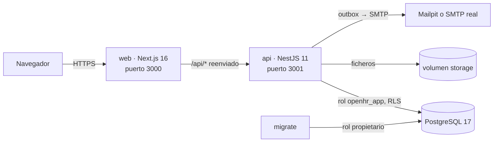

# Arquitectura

OpenHR es un **monolito modular** con dos aplicaciones en un monorepo de npm workspaces y una base de datos PostgreSQL.



## Piezas

| Pieza | Tecnología | Responsabilidad |
| --- | --- | --- |
| `apps/web` | Next.js 16 (App Router), React 19, CSS propio, AnimateIcons | Interfaz. Páginas cliente que llaman a la API. Un route handler (`src/app/api/[...path]/route.ts`) reenvía `/api/*` a `API_URL`: mismo origen y cookie sin CORS |
| `apps/api` | NestJS 11, `pg`, zod, pdf-lib, pdfjs-dist, nodemailer | Reglas de negocio, permisos, PDFs, exportaciones, outbox de emails |
| `db` | PostgreSQL 17 | Datos, aislamiento por RLS, inmutabilidad de fichajes |
| `migrate` | La imagen de la API con `node dist/db/migrate.js` | Crea el rol de aplicación y aplica migraciones con el rol propietario |
| `storage` | Disco, S3 o Azure Blob | Ficheros (nóminas, documentos, firmas). Adaptadores en `documents/storage-adapters.ts`, elegidos con `STORAGE_DRIVER`; cada fichero guarda su SHA-256 y se comprueba al leerlo |
| `mailpit` | SMTP de pruebas | Captura los emails en desarrollo |

## Módulos de la API

```
src/
  auth/           sesión (JWT), login, MFA TOTP, invitaciones, recuperación, configuración inicial, AuthGuard global
  org/            sociedades, centros, departamentos, festivos, tipos de ausencia, personas y roles
  time/           fichaje, correcciones, resumen diario (worktime.ts), cadena de hashes, sellos
  absences/       solicitudes, aprobación, saldo de vacaciones
  documents/      almacenamiento, documentos, lotes de nóminas y PDF (pdf.ts)
  exports/        CSV de registro de jornada y variables de nómina
  imports/        importación CSV de personas
  notifications/  bandeja, outbox y su procesador (OutboxWorker)
  common/         permisos (access.ts), calendario laboral (calendar.ts), fechas y zonas horarias,
                  cripto (AES-GCM, TOTP), DNI/NIE, filtro de errores
  db/             pool, transacción con tenant (Db.tx), migraciones
```

## Flujo de una petición

1. El navegador llama a `/api/...` en la web; el route handler la reenvía a la API con cookies y cuerpo, sin las cabeceras de IP que el cliente podría falsear.
2. Un middleware rechaza peticiones de escritura con un `Origin` distinto de `PUBLIC_URL`.
3. `AuthGuard` verifica el JWT (HS256) y, con `auth_session_check()`, que la cuenta está activa y la versión de sesión coincide.
4. El controlador valida la entrada con zod y abre `Db.tx(tenantId, userId, fn)`: `BEGIN`, `set_config('app.tenant_id', …, true)`, trabajo, `COMMIT`.
5. `loadActor(tx)` carga roles y relaciones laborales; los servicios aplican los permisos por sociedad o por responsable (`common/access.ts`).
6. Los efectos secundarios (notificaciones y emails) se escriben en la misma transacción: si algo falla, no sale nada.
7. `ErrorsFilter` traduce errores de PostgreSQL a 400/403/404/409 sin filtrar detalles internos.

## Decisiones clave

- **SQL directo con `pg`**: control total de RLS, bloqueos (`FOR UPDATE`) y consultas de informes, sin magia de ORM. Ver [base de datos](base-de-datos.md).
- **Aislamiento por RLS**: [ADR 0001](adr/0001-tenancy-rls.md).
- **Fichaje inmutable con cadena de hashes**: [ADR 0002](adr/0002-time-entry-hash-chain.md).
- **Sesiones revocables con JWT**: [ADR 0003](adr/0003-sesiones.md).
- **Outbox transaccional en PostgreSQL** en vez de una cola externa: menos piezas que autoalojar. El procesador corre dentro de la API (`OUTBOX_WORKER=false` lo desactiva si hay varias réplicas y se quiere uno dedicado).
- **Zona horaria por centro de trabajo**: cada fichaje cuenta en el día civil de su centro; los tramos que cruzan medianoche se reparten y los cambios de hora se calculan con `Intl`.
- **Nóminas**: OpenHR no calcula nóminas. Recibe el PDF de la gestoría y le entrega las variables del mes.
