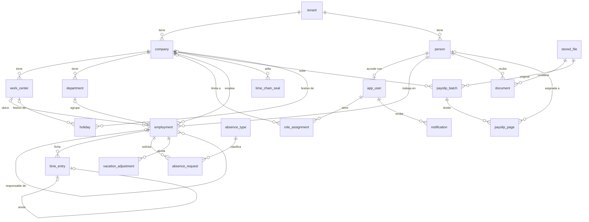

# Base de datos

OpenHR usa **PostgreSQL 17** con SQL directo (sin ORM). El esquema vive en `apps/api/migrations/*.sql`, que se aplican en orden alfabético con `apps/api/src/db/migrate.ts`.

## Roles de base de datos

| Rol | Para qué | Privilegios |
| --- | --- | --- |
| Propietario (`POSTGRES_OWNER_USER`, por defecto `openhr_owner`) | Ejecutar migraciones. | Dueño de tablas y funciones. En la imagen oficial de PostgreSQL es superusuario. |
| `openhr_app` | Conexión de la API. Lo crea `migrate.ts` con la contraseña `OPENHR_APP_DB_PASSWORD`. | `LOGIN NOSUPERUSER NOBYPASSRLS`. Lectura y escritura en tablas, salvo las append-only (solo lectura e inserción). Sujeto a RLS. |

## Aislamiento entre organizaciones (RLS)

- La función `app_tenant_id()` devuelve `current_setting('app.tenant_id')` como `uuid`, o `NULL` si no está fijado.
- `enable_tenant_rls(tabla)` activa RLS y crea la política `tenant_isolation`: `USING (tenant_id = app_tenant_id()) WITH CHECK (tenant_id = app_tenant_id())`.
- La API fija el contexto en cada transacción con `set_config('app.tenant_id', $1, true)` y `set_config('app.user_id', $2, true)` (`Db.tx()` en `apps/api/src/db/db.service.ts`).
- Un test de integración falla si alguna tabla con columna `tenant_id` no tiene RLS.

Más detalle en [ADR 0001](adr/0001-tenancy-rls.md).

## Diagrama entidad-relación

## Tablas

Convenciones: claves primarias `uuid` generadas con `gen_random_uuid()` (salvo `audit_event` y `outbox`, `bigserial`); marcas de tiempo `timestamptz` en UTC; fechas civiles `date` (la API las devuelve como texto `AAAA-MM-DD`); toda tabla de negocio lleva `tenant_id` con RLS.

### Organización

#### `tenant`
Instalación lógica: normalmente un grupo de empresas. Solo se crea con `setup_create_tenant()`.

| Columna | Tipo | Notas |
| --- | --- | --- |
| `id` | uuid | PK |
| `name` | text | Nombre del grupo |
| `created_at` | timestamptz | |

RLS: política `tenant_self` (`id = app_tenant_id()`). La app no puede insertar ni borrar.

#### `company` — sociedad
| Columna | Tipo | Notas |
| --- | --- | --- |
| `id`, `tenant_id` | uuid | |
| `name` | text | Nombre corto |
| `legal_name` | text | Razón social |
| `tax_id` | text | CIF. Único por tenant |
| `ccc` | text? | Código de cuenta de cotización |
| `address` | text? | |

#### `work_center` — centro de trabajo
| Columna | Tipo | Notas |
| --- | --- | --- |
| `company_id` | uuid | FK `company` |
| `name` | text | |
| `timezone` | text | IANA, por defecto `Europe/Madrid`. Decide a qué día cuenta cada fichaje |
| `region` | text? | Comunidad autónoma (ISO 3166-2:ES) |
| `address` | text? | |

#### `department`
`company_id`, `name` (único por sociedad).

#### `holiday` — festivos
| Columna | Tipo | Notas |
| --- | --- | --- |
| `company_id` | uuid? | Festivo de una sociedad |
| `work_center_id` | uuid? | Festivo local de un centro |
| `date` | date | |
| `name` | text | |

Sin sociedad ni centro = festivo de todo el grupo (los nacionales se cargan solos para el año actual y el siguiente).

#### `absence_type` — tipos de ausencia
| Columna | Tipo | Notas |
| --- | --- | --- |
| `code` | text | Único por tenant (`VAC`, `AP`, `IT`, `MAT`, `FAM`, `FALL`, `MUD`, `DEB`, `NR` de partida) |
| `name` | text | |
| `paid` | boolean | Retribuido |
| `counts_as_vacation` | boolean | Descuenta del saldo de vacaciones |
| `requires_approval` | boolean | Si es `false`, queda aprobada al registrarla (p. ej. IT) |
| `day_unit` | text | `working` (laborables) o `calendar` (naturales) |
| `sensitive` | boolean | Dato de salud: el responsable no ve el tipo ni el comentario |
| `active` | boolean | |

### Personas y accesos

#### `person` — persona física
`first_name`, `last_name`, `national_id` (DNI/NIE, único por tenant), `email`, `phone`, `birth_date`. Una persona puede tener varias relaciones laborales en el grupo.

#### `app_user` — cuenta de acceso
| Columna | Tipo | Notas |
| --- | --- | --- |
| `person_id` | uuid? | FK `person` |
| `email` | text | Único en toda la instalación (`lower(email)`) para iniciar sesión sin elegir organización |
| `password_hash` | text? | bcrypt (coste 12). `NULL` hasta aceptar la invitación |
| `totp_secret` | text? | Secreto TOTP cifrado con AES-256-GCM (`ENCRYPTION_KEY`) |
| `totp_enabled` | boolean | |
| `is_active` | boolean | |
| `session_version` | integer | Se incrementa por trigger al cambiar contraseña, MFA, email o al desactivar: revoca las sesiones |
| `last_login_at` | timestamptz? | |

#### `role_assignment`
| Columna | Tipo | Notas |
| --- | --- | --- |
| `user_id` | uuid | |
| `company_id` | uuid? | `NULL` = todo el tenant |
| `role` | text | `admin` o `hr` |

Ser empleado o responsable no necesita fila: se deriva de `employment`.

#### `employment` — relación laboral
| Columna | Tipo | Notas |
| --- | --- | --- |
| `person_id`, `company_id` | uuid | |
| `work_center_id`, `department_id` | uuid? | Deben ser de la misma sociedad (lo comprueba la API) |
| `manager_employment_id` | uuid? | Responsable directo (otra relación laboral) |
| `employee_number`, `job_title`, `contract_type` | text? | |
| `start_date`, `end_date` | date | `end_date` nula = vigente |
| `weekly_minutes` | integer | Jornada semanal |
| `schedule` | jsonb | Minutos de jornada teórica por día ISO: `{"1":480,…,"7":0}` |
| `vacation_days_per_year` | numeric(5,1) | Días laborables al año (prorrateados el primer y último año) |
| `time_chain_head`, `time_chain_seq` | text, bigint | Cabeza de la cadena de fichajes |

### Ciclo de vida y campos personalizados

#### `checklist_template` y `checklist_template_item`
Plantillas de alta (`onboarding`), baja (`offboarding`) o traspaso (`transfer`), de una sociedad o generales (`company_id` nulo). Cada tarea tiene `title`, `description`, `assignee` (`hr`, `manager` o `employee`) y `due_offset_days` respecto a la fecha del alta, baja o traspaso.

#### `checklist` y `checklist_task`
Checklist de una relación laboral (`kind`, `name`, `reference_date`, `status` `open`/`done`/`cancelled`) y sus tareas (`due_date`, `done_at`, `done_by`, `note`). Se crean solos al dar de alta, dar de baja o traspasar si hay una plantilla activa (la de la sociedad o, si no, la general).

#### `custom_field`
Definición de un campo propio: `entity` (`person` o `employment`), `key` (única, `^[a-z][a-z0-9_]+$`), `label`, `type` (`text`, `number`, `date`, `boolean`, `select` con `options`), `required`, `visibility` (`hr`, `manager` o `employee`), `position`, `active`. Los valores se guardan en la columna `custom_values` (jsonb) de `person` o `employment`, validados por la API.

`employment.transferred_from_employment_id` enlaza la relación laboral nueva de un traspaso con la anterior.

### Registro de jornada

#### `time_entry` — fichajes (append-only)
| Columna | Tipo | Notas |
| --- | --- | --- |
| `employment_id` | uuid | |
| `seq` | bigint | Posición en la cadena. Único por relación laboral |
| `kind` | text | `in`, `out`, `break_start`, `break_end`, `void` |
| `occurred_at` | timestamptz | Hora del servidor (fichaje real) o declarada (manual) |
| `recorded_at` | timestamptz | Cuándo se registró |
| `device_time` | timestamptz? | Hora que decía el dispositivo (informativa) |
| `source` | text | `clock`, `manual`, `import` |
| `voids_entry_id` | uuid? | Fichaje que anula (solo `void`; un fichaje solo se anula una vez) |
| `reason` | text? | Obligatorio salvo `source = clock` |
| `created_by` | uuid | Usuario que lo registró |
| `idempotency_key` | text? | Único por tenant: reintentos sin duplicados |
| `content_digest`, `prev_hash`, `hash` | text | Cadena: `hash = sha256(prev_hash ‖ content_digest)` |

Protecciones: el rol `openhr_app` no tiene `UPDATE` ni `DELETE`, y los triggers `time_entry_no_update` y `time_entry_no_truncate` lo impiden incluso al propietario. Ver [ADR 0002](adr/0002-time-entry-hash-chain.md).

#### `time_chain_seal` — sellos (append-only)
`company_id`, `sealed_at`, `heads` (jsonb `{employment_id: {seq, hash}}`), `digest` (SHA-256), `sent_to` (emails).

### Turnos y bolsa de horas

#### `shift_template` — plantilla de turno
`company_id`, `name` (único por sociedad), `start_time`, `end_time` (si es anterior o igual a la entrada, el turno acaba al día siguiente), `break_minutes`, `color` (`sky`, `navy`, `teal`, `amber`, `violet`, `rose`, `slate`), `active`.

#### `shift_assignment` — turno asignado
| Columna | Tipo | Notas |
| --- | --- | --- |
| `employment_id`, `date` | | Único por relación laboral y fecha (fecha local de inicio) |
| `shift_template_id` | uuid? | Plantilla de la que sale (o turno a medida) |
| `is_day_off` | boolean | Día libre planificado |
| `start_at`, `end_at` | timestamptz? | Obligatorios salvo día libre |
| `break_minutes` | integer | Pausa no computable |
| `published_at` | timestamptz? | `NULL` = borrador. Solo los publicados cuentan como jornada teórica y los ve la persona |

Un turno publicado sustituye a la jornada semanal ese día, aunque sea festivo.

#### `hour_bank_adjustment`
Movimientos manuales de la bolsa: `date`, `minutes` (positivo o negativo), `kind` (`opening` saldo inicial, `paid` horas pagadas en nómina, `adjustment`), `reason`.

Columnas añadidas: `employment.hour_bank_enabled` y `hour_bank_start`; `absence_type.consumes_hour_bank` (el tipo `COMP`, «Compensación de horas», viene creado); y en `company` las reglas de jornada: `min_rest_between_shifts_minutes` (720), `max_daily_ordinary_minutes` (540), `min_weekly_rest_minutes` (2160) y `max_yearly_overtime_minutes` (4800).

### Ausencias

#### `absence_request`
| Columna | Tipo | Notas |
| --- | --- | --- |
| `employment_id`, `absence_type_id` | uuid | |
| `start_date`, `end_date` | date | Inclusive |
| `days` | numeric(5,1) | Calculados al solicitar con la jornada y los festivos |
| `status` | text | `pending`, `approved`, `rejected`, `cancelled` |
| `comment`, `decision_comment` | text? | |
| `requested_by`, `decided_by`, `decided_at` | | |

#### `approval_flow` — circuito de aprobación
`company_id` y `absence_type_id` (ambos opcionales; único por combinación, con `NULLS NOT DISTINCT`) y `steps`: lista JSON de 1 a 5 pasos `{"kind": "manager" | "manager_of_manager" | "hr" | "admin" | "user", "userId"?}`. Se aplica el más específico; sin ninguno, un paso: el responsable directo. Las ausencias sensibles las aprueba siempre RR. HH.

#### `approval_step` — pasos de cada solicitud
| Columna | Tipo | Notas |
| --- | --- | --- |
| `request_id`, `step_index` | | Único por solicitud y posición |
| `kind`, `target_user_id` | | Copia del paso del circuito al crear la solicitud |
| `approver_user_ids` | uuid[] | Aprobadores resueltos al activar el paso (nunca quien solicita) |
| `status` | text | `waiting`, `pending` (paso actual), `approved`, `rejected`, `skipped` (sin aprobadores), `cancelled` |
| `decided_by`, `decided_as`, `decided_at`, `comment` | | `decided_as`: `approver`, `delegate` o `hr` (RR. HH. resuelve la solicitud entera) |

`absence_request.current_step` apunta al paso pendiente. Si ningún paso tiene aprobadores, se añade uno de RR. HH. y, en último caso, de administración.

#### `approval_delegation`
`from_user_id`, `to_user_id` (distintos), `start_date`, `end_date`, `reason`. Mientras está vigente, `to_user_id` puede resolver los pasos de `from_user_id` y recibe sus avisos.

#### `vacation_adjustment`
Ajustes manuales del saldo por año (`days` positivo o negativo, `reason` obligatorio).

### Documentos y nóminas

#### `stored_file`
Metadatos de un fichero guardado en el almacenamiento (disco en el MVP): `storage_key`, `filename`, `content_type`, `size_bytes`, `sha256` (se comprueba al leer).

#### `document` — «Mis documentos»
`person_id`, `company_id`, `file_id`, `category` (`payslip`, `contract`, `certificate`, `other`), `title`, `period` (`AAAA-MM`), `batch_id`, `published_at`, `first_read_at` (acuse de lectura: primera descarga de la propia persona).

#### `payslip_batch`
Un PDF con las nóminas de una sociedad y un mes: `period`, `file_id`, `page_count`, `status` (`review`, `published`, `discarded`), `published_by`, `published_at`.

#### `payslip_page`
Una fila por página: `detected_ids` (DNI/NIE válidos encontrados), `suggested_person_id`, `person_id`, `review_status` (`pending`, `confirmed`, `skipped`). Una página confirmada debe tener persona; el lote no se publica con páginas pendientes.

### Comunicación y firma

#### `announcement` y `announcement_read`
Anuncios de una sociedad o de todo el grupo (`company_id` nulo): `title`, `body`, `pinned`, `published_at`, `expires_at`, `archived`. `announcement_read` guarda quién lo leyó y cuándo.

#### `policy` y `policy_acceptance`
Políticas internas en PDF (`file_id`), por sociedad o del grupo. `series_id` agrupa las versiones de una misma política (`version` única por serie); publicar una versión archiva la anterior y obliga a aceptarla de nuevo. La aceptación guarda persona, usuario, fecha, IP, navegador y el SHA-256 del fichero aceptado.

#### `signature_request`
Solicitud de firma de un PDF a una persona: `title`, `message`, `file_id`, `status` (`pending`, `signed`, `declined`, `cancelled`), `due_date`. El código de un solo uso se guarda como hash (`otp_hash`, `otp_expires_at`, `otp_attempts`, máximo 5). Al firmar: `signed_file_id` (PDF con hoja de evidencias), `document_id` (copia en «Mis documentos», categoría `signed`) y `evidence` (jsonb con firmante, DNI/NIE, email, fecha, IP, navegador, método, declaración y huellas del original y del firmado).

`document.category` admite además `policy` y `signed`.

### Sistema

#### `audit_event` (append-only)
`actor_id`, `action` (p. ej. `employee.created`, `time.voided`, `export.time_register`), `entity`, `entity_id`, `data` (jsonb), `created_at`.

#### `notification`
Bandeja de cada usuario: `type`, `title`, `body`, `link`, `read_at`.

#### `outbox`
Cola transaccional de emails: `type`, `payload`, `attempts`, `last_error`, `available_at`, `processed_at`. Al enviarse, el cuerpo se borra y solo quedan destinatario y asunto.

#### `schema_migrations`
`name`, `checksum`, `applied_at`. Una migración aplicada no puede cambiar (el checksum lo detecta).

## Funciones `SECURITY DEFINER`

Son las únicas puertas que cruzan organizaciones. Todas tienen `search_path` fijo y `EXECUTE` revocado a `PUBLIC`.

| Función | Uso |
| --- | --- |
| `auth_find_user(email)` | Inicio de sesión y recuperación de contraseña |
| `auth_session_check(user_id, tenant_id)` | Validar en cada petición que la cuenta está activa y la versión de sesión |
| `setup_create_tenant(name)` | Configuración inicial; falla si ya existe algún tenant |
| `setup_is_done()` | ¿Está configurada la instalación? |
| `outbox_claim(limit)` | Reservar emails pendientes (`FOR UPDATE SKIP LOCKED`, arrendamiento de 5 min) |
| `outbox_finish(id, error)` | Marcar enviado (y borrar el cuerpo) o programar reintento con espera exponencial |

## Migraciones

| Fichero | Contenido |
| --- | --- |
| `001_core.sql` | Tenant, sociedades, centros, departamentos, personas, usuarios, roles, relaciones laborales, festivos, auditoría, notificaciones, outbox |
| `002_time_tracking.sql` | Fichajes inmutables y sellos |
| `003_absences.sql` | Tipos y solicitudes de ausencia, ajustes de vacaciones |
| `004_documents.sql` | Ficheros, documentos, lotes y páginas de nómina |
| `005_security.sql` | RLS, permisos del rol de aplicación y funciones definer |
| `006_session_hardening.sql` | Versión de sesión, comprobación de sesión y borrado del cuerpo de los emails enviados |
| `007_shifts_hour_bank.sql` | Turnos, reglas de descanso por sociedad y bolsa de horas |
| `008_approvals.sql` | Circuitos de aprobación, pasos por solicitud y delegaciones |
| `009_lifecycle_custom_fields.sql` | Checklists de alta, baja y traspaso, traspasos y campos personalizados |
| `010_communication_signature.sql` | Anuncios, políticas con aceptación y firma individual |

Para añadir una tabla: crea `00N_nombre.sql`, incluye `tenant_id uuid NOT NULL REFERENCES tenant(id)` y llama a `SELECT enable_tenant_rls('nombre')`. Nunca edites una migración ya aplicada.

## Retención (pendiente para la V1)

El registro de jornada se conserva 4 años. La purga por periodos sellados y la anonimización se describen en [ADR 0002](adr/0002-time-entry-hash-chain.md).
