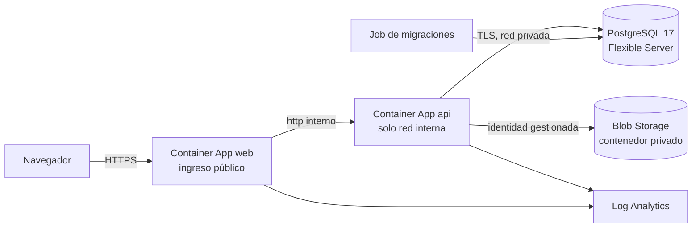

# Despliegue en Azure

Para cuando la instalación con Docker Compose se queda corta: alta disponibilidad, copias de seguridad gestionadas y escalado. La infraestructura está en `infra/azure` (Terraform).

## Qué se crea



| Recurso | Detalles |
| --- | --- |
| Grupo de recursos | `rg-<nombre>` en `spaincentral` por defecto (los datos se quedan en España) |
| Red virtual | Subred delegada para Container Apps y otra para PostgreSQL |
| PostgreSQL Flexible Server 17 | Sin acceso público, DNS privado, copias de 35 días, alta disponibilidad opcional (`postgres_high_availability`) |
| Storage Account | Contenedor privado `openhr`, ZRS, TLS 1.2, sin claves compartidas, versiones y papelera de 30 días |
| Identidad gestionada | La API escribe en el almacenamiento con el rol *Storage Blob Data Contributor*, sin secretos |
| Container Apps | `api` (solo interna), `web` (pública, HTTPS automático) y el job `migrate` |
| Log Analytics | Registros de los contenedores, 30 días |

Los secretos (contraseñas de base de datos, `JWT_SECRET`, `ENCRYPTION_KEY`, `SETUP_TOKEN`) los genera Terraform y se guardan como secretos de Container Apps.

## Requisitos

- Terraform 1.6 o superior y la CLI de Azure (`az login`).
- Imágenes publicadas: el workflow de GitHub Actions las sube a `ghcr.io/<propietario>/openhr-api` y `openhr-web` en cada push a `main` y en cada etiqueta `v*`. Si el paquete es privado, crea un token con `read:packages` y rellena `registry_*`.
- Un servidor SMTP (Azure Communication Services, SendGrid, el de tu dominio…).

## Pasos

```bash
cd infra/azure
cp terraform.tfvars.example terraform.tfvars   # rellena suscripción, imágenes y SMTP
terraform init
terraform apply
```

Al terminar:

```bash
terraform output -raw run_migrations | sh      # aplica las migraciones (también tras cada actualización)
terraform output url                            # dirección de OpenHR
terraform output -raw setup_token               # lo pide la configuración inicial
terraform output -raw encryption_key            # guárdala fuera de Azure
```

Abre la URL y completa la configuración inicial con el token.

Opcionales en `terraform.tfvars`: `tsa_url` (sello de tiempo RFC 3161 de los sellos del registro de jornada) y `clamav_host` / `clamav_port` (antivirus para los ficheros subidos; este módulo no despliega ClamAV, debe ser un `clamd` accesible desde la API). La API puede escalar a varias réplicas sin más ajustes: los límites de intentos se cuentan en PostgreSQL.

## Dominio propio

Añade el dominio a la Container App `web` (`az containerapp hostname add` y `bind`, con certificado gestionado gratuito), pon `public_url = "https://rrhh.ejemplo.com"` en `terraform.tfvars` y vuelve a aplicar: la API solo acepta peticiones de ese origen.

## Actualizar

1. Publica una etiqueta (`git tag v1.2.0 && git push --tags`) o usa `latest`.
2. Cambia `image_api` e `image_web` si fijas versión y ejecuta `terraform apply`.
3. Lanza el job de migraciones.

## Estado de Terraform

Por defecto el estado es local (`terraform.tfstate`, que contiene secretos y no se sube a Git). Para un equipo, guárdalo en un Storage Account con un bloque `backend "azurerm"` y acceso restringido.

## Coste orientativo

Con `B_Standard_B1ms` y una réplica de cada aplicación, el piloto ronda las decenas de euros al mes; la base de datos es la mayor parte. Revísalo en la calculadora de Azure para tu región.
